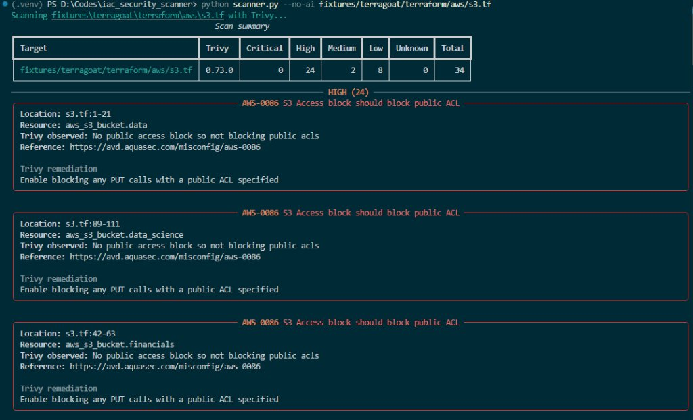
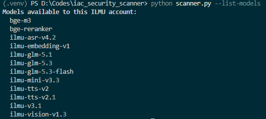
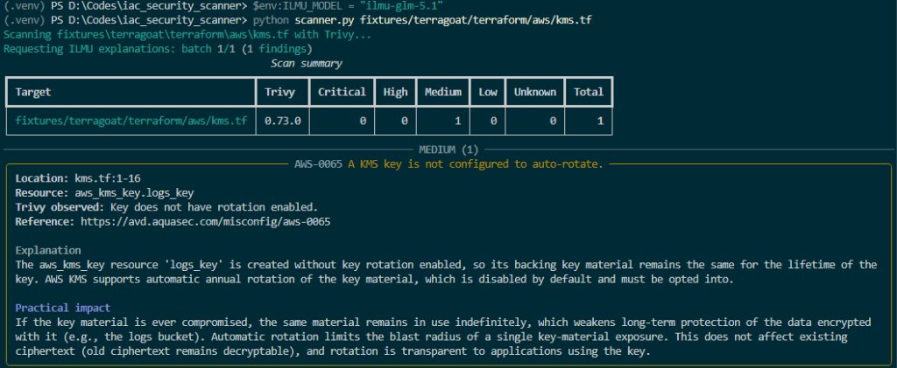
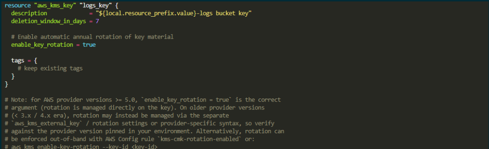

# Infrastructure as Code Security Scanner with AI Remediation

<p align="center">
  
  
  
  
  
</p>

A DevSecOps terminal CLI that combines **deterministic static analysis** (via [Trivy](https://trivy.dev/)) with **generative AI remediation** powered by sovereign Malaysian LLMs hosted on [YTL AI Labs](https://www.ytlailabs.com/) (`ilmuapi`).

> **Architectural Principle**: Trivy is the immutable, reproducible detection source of truth; YTL's ILMU acts as the pedagogical and remediation layer. The AI does not invent or dispute findings—it translates cryptic CVE/rule findings into plain-English explanations, real-world business blast-radius assessments, and syntax-highlighted HCL remediation snippets.

---

## Visual Showcase

### 1. Deterministic Trivy Scan & Rich Severity Summary
Run offline or in blocking CI/CD gates without spending API tokens:


### 2. Dynamic Model Discovery via YTL AI Labs
Query model IDs available to your account without consuming inference completion quota:


### 3. AI-Powered Remediation & Threat Blast Radius
ILMU explains the misconfiguration, context, and practical consequences (e.g., KMS auto-rotation wear-out, PCI-DSS compliance):


### 4. Monokai Syntax-Highlighted Terraform HCL Diff
Actionable, copy-pasteable Terraform HCL code blocks tailored to modern AWS provider versions (>= 5.0):


---

## Architecture & Data Flow

```text
       Terraform Files (.tf)
                 │
                 ▼
 ┌───────────────────────────────┐
 │   TRIVY (Deterministic Core)  │  <-- Scans against CIS AWS Benchmarks
 └───────────────┬───────────────┘
                 │
                 ▼ Captured in-memory (stdout JSON)
 ┌───────────────────────────────┐
 │   Data Normalization Pipeline │  <-- Filters "FAIL", extracts AST line ranges
 └───────────────┬───────────────┘
                 │
                 ▼ "Token Diet" Payload Reduction (Trimmed JSON)
 ┌───────────────────────────────┐
 │   YTL AI Labs (ILMU GLM-5.1)  │  <-- Injected with prompt injection defense
 └───────────────┬───────────────┘      Batched in chunks of 10 findings
                 │
                 ▼ Reconciled by immutable keys (finding-1, finding-2)
 ┌───────────────────────────────┐
 │   Rich Terminal Presentation  │  <-- Severity tables & Monokai HCL diffs
 └───────────────────────────────┘
```

---

## Key Features

- **Shift-Left Static Analysis**: Employs Trivy to audit Terraform configurations against CIS benchmarks, AWS Well-Architected Framework, and cloud security best practices.
- **Enterprise-Grade AI Enrichment**: Leverages YTL AI Labs' `ilmu-glm-5.1` / `ilmu-glm-5.3-flash` models via an OpenAI-compatible API to generate plain-English explanations and actionable remediation steps.
- **Token Diet & Cost Optimization**: Raw 50KB+ Trivy output is stripped of engine plumbing. Only semantic fields (rule ID, resource name, code excerpt) are dispatched, reducing token burn by up to 80%.
- **Indirect Prompt Injection Hardening**: Prompts explicitly sandbox scanned Terraform code as untrusted data to prevent malicious comments from altering LLM evaluation.
- **Fixed Batching & Key Reconciliation**: Findings are processed in chunks of 10. AI responses are joined strictly by immutable dictionary keys (`finding-k`), eliminating positional array reordering bugs.
- **Token Bounding & Circuit Breaker**: Caps output tokens at 5,000 per batch and halts subsequent API calls immediately on network or schema failures to protect quota.
- **Zero Disk Residue**: Pipes all scanner outputs directly through memory streams. No temporary scan reports are written to disk.

---

## Prerequisites

- **Python**: 3.11 or newer (tested with Python 3.13)
- **Trivy**: Installed and available on system `PATH` (tested with 0.73.0)
- **ILMU API Key**: Valid API key from [YTL AI Labs](https://api.ilmu.ai/)

Verify local tooling:
```powershell
python --version
trivy --version
```

---

## Quickstart

### 1. Set Up Virtual Environment

```powershell
python -m venv .venv
.\.venv\Scripts\Activate.ps1
python -m pip install -r requirements.txt
```

### 2. Clone Vulnerable Fixture (Optional Test Fixture)

```powershell
git clone https://github.com/bridgecrewio/terragoat.git fixtures/terragoat
```

> **Safety Warning**: [TerraGoat](https://github.com/bridgecrewio/terragoat) is intentionally vulnerable. Only perform static analysis on these files. Never run `terraform apply` or deploy them to a cloud environment.

### 3. Configure YTL AI Labs Credentials

Set your credentials in your current terminal session (never commit credentials or use `--api-key` CLI flags):

```powershell
$env:ILMU_API_KEY = "your-sk-prefixed-ilmu-key"
```

Discover available models for your account:
```powershell
python scanner.py --list-models
```

Select your model (e.g., `ilmu-glm-5.1` or `ilmu-glm-5.3-flash`):
```powershell
$env:ILMU_MODEL = "ilmu-glm-5.1"
```

---

## Usage

### Deterministic Scan Only (No Tokens Spent)
Ideal for pre-commit hooks and blocking CI/CD pipelines:
```powershell
python scanner.py --no-ai fixtures/terragoat/terraform/aws/s3.tf
```

### Full AI Scan with YTL ILMU Remediation
```powershell
# Scan single file
python scanner.py fixtures/terragoat/terraform/aws/kms.tf

# Scan full AWS directory
python scanner.py fixtures/terragoat/terraform/aws
```

---

## Project Structure

```text
.
├── docs/
│   └── images/                 # Execution screenshots and terminal UI captures
├── fixtures/
│   └── terragoat/              # Vulnerable Terraform fixtures (Git ignored)
├── .gitignore
├── requirements.txt            # Python dependencies (openai, rich)
├── scanner.py                  # Complete CLI application source
└── README.md
```

---

## Acknowledgments

Special thanks to **[YTL AI Labs](https://www.ytlailabs.com/)** for providing API access and compute tokens to explore applied AIOps and cloud security workflows on sovereign AI infrastructure.
